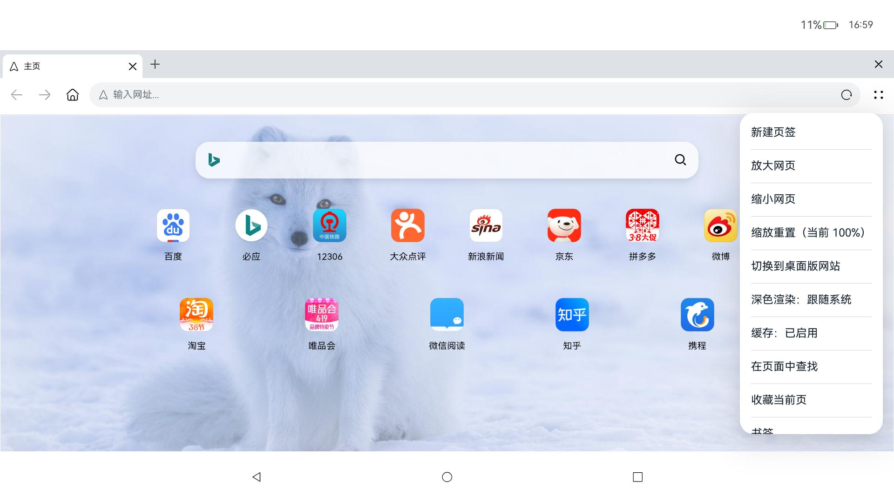
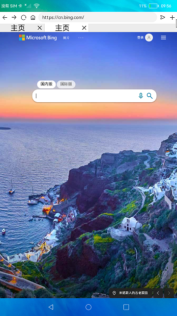

# 浏览器

### 介绍
本示例基于 [Web 组件](https://docs.openharmony.cn/pages/v5.0/zh-cn/application-dev/reference/apis-arkweb/js-apis-web.md)展示了一个浏览器的基本功能：展示网页、多页签管理、根据页面历史栈前进回退等，并适配手机与平板（横屏/竖屏）两种窗口形态。

### 效果预览

|首页|打开网址|
|----|------|
|||

使用说明:
1. 连接Wifi，启动应用，展示默认页面内容;
2. 点击默认页面的图标跳转到对应网页，或者在输入框输入网址（自动补全协议，输入普通文本则作为搜索词跳转搜索）;
3. 页签条可点击切换网页，点击页签上的关闭按钮关闭对应页签（至少保留一个页签）;
4. 点击输入框左侧前进后退按钮进行页面的前进后退，点击主页图标回到主页，点击加号按钮新建页面（页签上限 10 个）;
5. 布局按窗口宽度断点（600vp）切换：宽度小于断点时使用单页签 + 底部工具栏布局，否则使用多页签布局；手机横竖屏、平板分屏、2in1 自由窗口缩放时自动切换，且 Web 组件常驻、浏览状态不丢失;
6. 手机布局存在多个页签时会在工具栏上方显示页签条，可切换页签；前进/后退/关闭按钮不可用时图标置灰;
7. 首页与标题栏跟随系统深浅色，网页内容使用 WebDarkMode.Auto 同步切换。

### 工程目录
```
entry/src/main/ets/
|---Application
|   |---AbilityStage.ts                         // 入口
|---pages
|   |---Index.ets                               // 首页（窗口宽度断点、横竖屏布局切换）
|---common
|   |---PhoneLayout.ets                         // 手机端地址栏与底部工具栏
|   |---TitleBar.ets                            // 平板端标题栏、页签条与 Web 组件
|---model
|   |---Logger.ts                               // 日志工具
|   |---Browser.ets                             // 浏览器实例
|   |---UrlFormatter.ts                         // 地址栏输入归一化（纯函数）
tests/
|---formatUrl.test.mjs                          // 单元测试（node --test）
|---check-json5.mjs                             // 静态检查：json5 配置可解析
|---check-resources.mjs                         // 静态检查：$r/$rawfile 与配置资源引用均已定义
|---check-structure.mjs                         // 静态检查：导入符号、ForEach 三参数、rawfile HTML 结构
```

### 具体实现
+ Web展示与历史栈操作功能在Browser中，源码参考[Browser.ets](entry/src/main/ets/model/Browser.ets)
  + 加载网页及刷新：使用WebController提供的loadUrl可以加载目标网址内容，使用refresh方法刷新页面;
  + 页面前进后退功能：页面在前进或者后退前使用accessForward/accessBackward查询是否有历史记录,然后调用forward/backward进行前进/后退操作;
  + 前进后退可用态：onPageEnd 与页签切换后调用 updateHistoryState 同步 canBack/canForward，供工具栏置灰展示;
  + 地址栏输入归一化：[UrlFormatter.ts](entry/src/main/ets/model/UrlFormatter.ts) 对输入做协议补全与搜索词归一化;
+ 横竖屏适配：源码参考[Index.ets](entry/src/main/ets/pages/Index.ets)
  + 用 mediaquery 监听窗口宽度断点 `(width<600vp)` 决定布局，手机横竖屏、平板分屏与 2in1 自由窗口缩放都能正确切换；断点查询失败时退回设备形态判定;
  + 起始首页按设备形态选定后运行期不再变化，Web 组件常驻组件树，横竖屏切换时不销毁，浏览状态不丢失;
+ 首页页面：[phone.html](entry/src/main/resources/rawfile/phone.html) 与 [pad.html](entry/src/main/resources/rawfile/pad.html)
  + 页面自绘深浅色变量（prefers-color-scheme），站点栅格按宽度自适应并在矮屏/横屏时压缩留白，站点区可滚动。

### 相关权限

[ohos.permission.INTERNET](https://gitee.com/openharmony/docs/blob/master/zh-cn/application-dev/security/AccessToken/permissions-for-all.md#ohospermissioninternet)

[ohos.permission.GET_WIFI_INFO](https://gitee.com/openharmony/docs/blob/master/zh-cn/application-dev/security/AccessToken/permissions-for-all.md#ohospermissionget_wifi_info)

### 依赖

不涉及。

### 约束与限制

1. 本示例仅支持标准系统上运行;
2. 本示例已适配API version 12版本SDK（OpenHarmony 5.0.0 Release），版本号：5.0.0.12;
3. 本示例需要使用DevEco Studio 5.0.0及以上版本（配套hvigor 3.0.9）才可编译运行;
4. 单元测试与静态检查依赖Node.js 22.6+：根目录执行 `node --test` 运行单测，执行 `npm run check`（即 `node tests/check-json5.mjs && node tests/check-resources.mjs && node tests/check-structure.mjs`）运行静态检查。

### 下载

如需单独下载本工程，执行如下命令：
```
git init
git config core.sparsecheckout true
echo code/BasicFeature/Web/Browser/ > .git/info/sparse-checkout
git remote add origin https://gitee.com/openharmony/applications_app_samples.git
git pull origin master
```
